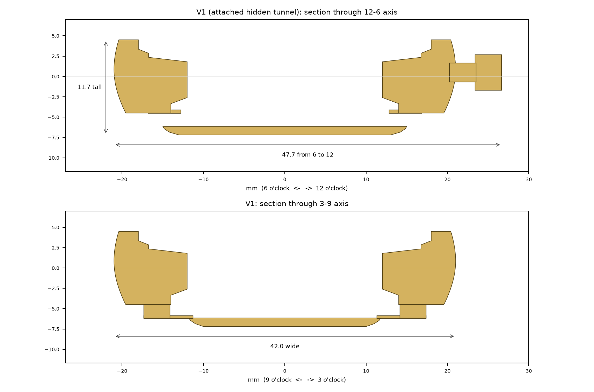
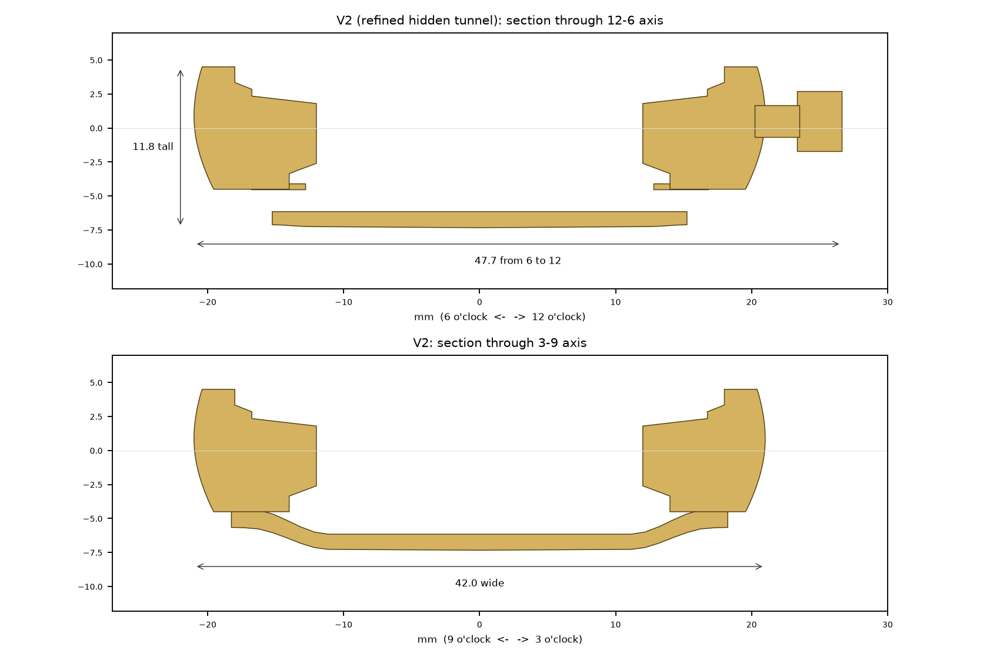
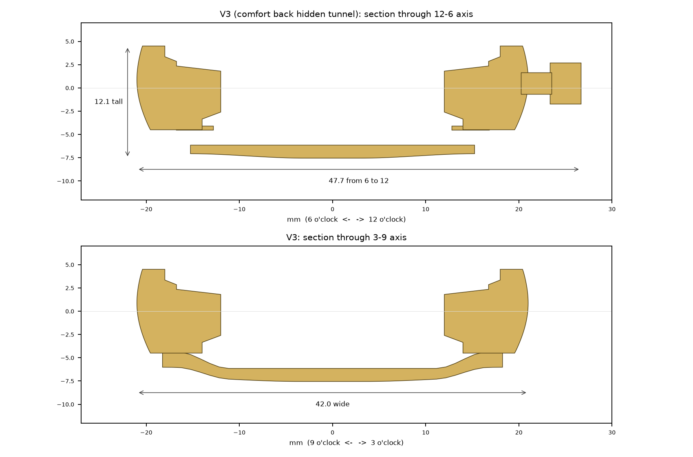
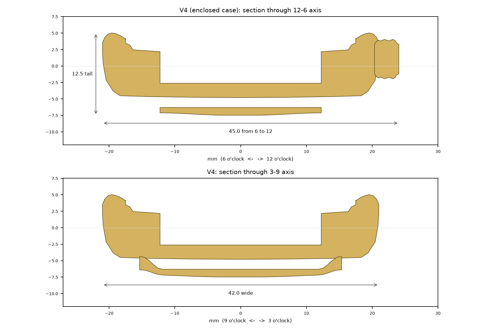
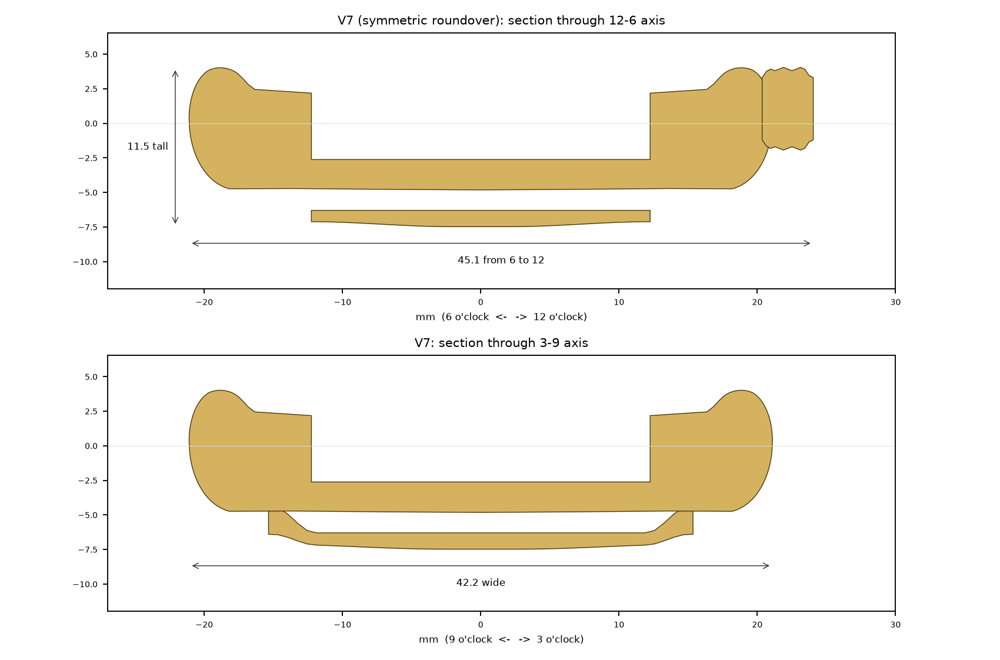
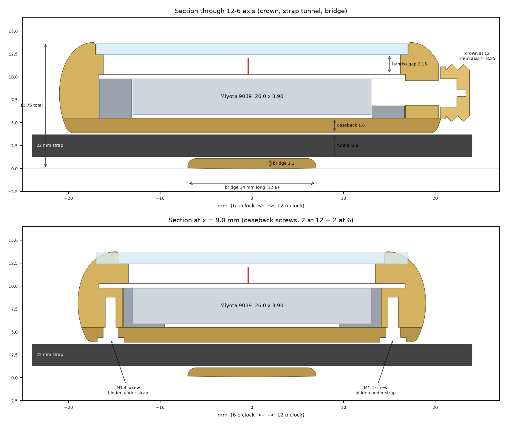
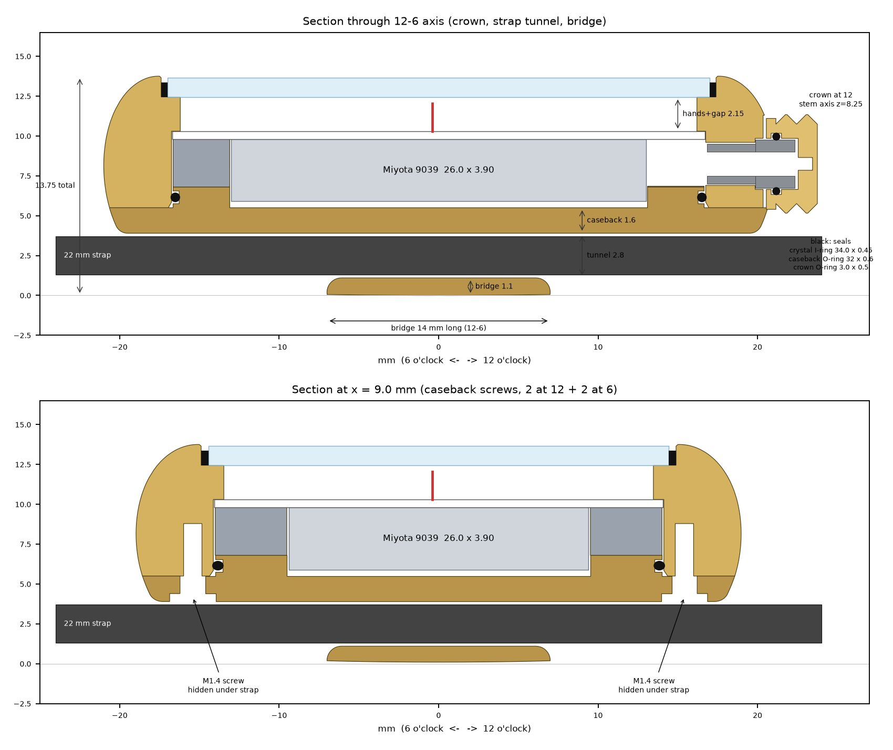
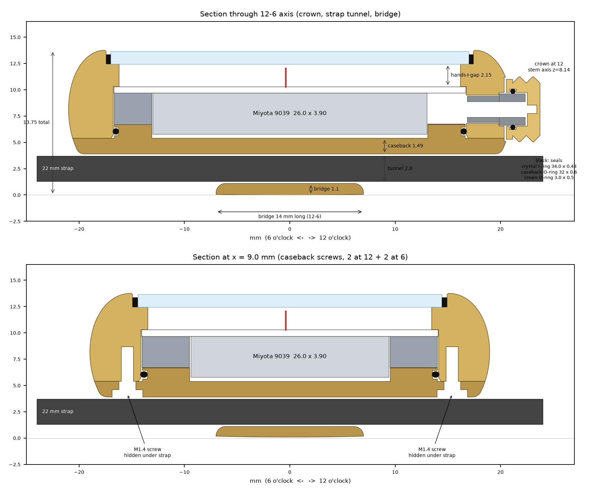

# Version history

How the case evolved, one version at a time: what changed, why, and the numbers. Each version has a section diagram cut through the 12-6 axis (crown and strap tunnel) and the 3-9 axis. V5 and V6 were never built.

## At a glance

| Version | Date | Wide (3-9) | Long (6 to 12, with crown) | Tall | The big change |
|---|---|---|---|---|---|
| V1 | 2026-10-11 | 42.0 | 47.7 | 11.7 | Hidden strap tunnel under the case |
| V2 | 2026-10-11 | 42.0 | 47.7 | 11.8 | Smooth, curved tunnel shoulders |
| V3 | 2026-10-11 | 42.0 | 47.7 | 12.1 | Wrist-contoured underside |
| V4 | 2026-10-13 | 42.0 | 45.1 | 12.5 | Enclosed caseback, domed top, bigger crown |
| V7 | 2026-10-13 | 42.2 | 45.1 | 11.5 | Symmetric roundover, upper curve matched to the lower |
| V8 | 2026-10-13 | 42.0 | 44.8 | 13.75 | Rebuilt as a parametric design around a real movement |
| V9 | 2026-10-15 | 42.0 | 44.8 | 13.75 | Sealed for water resistance |
| V10 | 2026-10-19 to 10-21 | 42.0 | 44.8 | 13.75 | Fitted to the real dial, screws and crystal gasket |

All dimensions in mm. V8 onwards are taller because they're the first versions built around a real movement, dial, hands and crystal stack.

---

## V1: hidden strap tunnel

**What it set out to do:** a lugless case where the strap disappears underneath, running from 12 to 6 through a hidden tunnel, so the top stays a clean, smooth shape.

- 42.0 mm case, 36.0 mm crystal opening, 33.5 mm visible dial
- Crown at 12 o'clock
- The strap bridge attaches at 3 and 9, outside the 22 mm strap lane, with box-like side cheeks

**Why:** to prove the core idea: a 22 mm strap can run under the case without lugs.

## V2: smooth tunnel shoulders

**Changed from V1**
- The rectangular bridge attachments became a smooth underside saddle
- The 3 and 9 o'clock attachments are continuous curved shoulders instead of boxy cheeks

**Why:** V1's cheeks read as structural add-ons. The tunnel should feel like part of one shape.

## V3: comfort back

**Changed from V2**
- The wrist-facing underside is contoured: the centre sits lowest and the back lifts gradually toward the edges

**Why:** a flat back with sharp edges creates pressure points. A watch should rest on the wrist on a gentle curve.

## V4: enclosed back, domed top

**Changed from V3** (after holding the first physical print)
- The movement cavity is enclosed by a caseback, so the strap path is separate from the inside of the watch
- The strap lane widened to about 24 mm, so a 22 mm strap threads and adjusts easily
- The underside bridge got shorter from 12 to 6, leaving room for future caseback screws
- The top is rounded further into a continuous dome, with no flat bezel shelf
- Front opening reduced to 35.0 mm for a wider-looking bezel shoulder
- The crown is larger and sits closer to the case, with a faceted texture

**Why:** the print showed the open back and flat top looked and felt unfinished, and a real watch needs a closed back.

## V7: symmetric roundover

**Changed from V4**
- The upper side starts tapering inward earlier, with a larger-radius top roundover instead of a mostly vertical wall ending in a small top corner

**Why:** to make the top curve match the bottom curve, so the side profile reads as one balanced shape.

## V8: rebuilt as a real design

**Changed from V7:** a complete rebuild, from a hand-shaped mesh to a precise, parametric design where every dimension comes from the parts that go inside.

- **Shape:** one continuous, curvature-smooth outer profile, so polished reflections flow without kinks
- **Size:** 42.00 mm wide, 13.75 mm tall (thickness/diameter 0.327); bezel opening 34.7 mm, visible dial 32.4 mm
- **Built around a Miyota 9039 automatic:** 0.4 mm rotor clearance, 1.75 mm hand stack with 0.4 mm clearance, 34.0 × 1.2 mm flat crystal
- **Crown at 12:** Clous de Paris pattern, 2 rows × 16 pyramids, collar tucked into a counterbore
- **Strap:** 22 mm through a 23.0 × 2.8 mm tunnel; the bridge is only 14 mm long, so the strap drapes naturally
- **Caseback:** 4 M1.4 screws, 2 at 12 and 2 at 6, heads flush in the strap channel, hidden when worn
- **Separate parts:** case body, caseback with bridge, crown, movement ring

**Why:** the earlier versions proved the look. To become a real watch, the case had to fit a real movement, crystal and screws to fractions of a millimetre.

## V9: sealed for water resistance

**Changed from V8:** each of the three places water can get in now has a standard watch seal, sized to off-the-shelf gaskets. Target: about 3 ATM (rain, hand-washing, splashes) with the crown pushed in.

- **Crystal:** a plastic I-ring gasket around the crystal, pressed in by a watchmaker, so it can be serviced (no glue). The bezel edge moved out slightly so the seat doesn't leave a thin, chip-prone edge.
- **Caseback:** a raised ring on the caseback enters the movement opening and carries an O-ring that seals against its wall. The seal doesn't depend on screw tightness, and the ring also centres the caseback. A small lead-in stops the O-ring being cut on assembly.
- **Crown:** a standard crown tube, the replaceable wear part, with an O-ring inside the crown sealing on the tube. The tube sits in a small pocket, so it fits as supplied.
- **Considered and rejected:** a tubeless crown sealing straight into the case. It would make the case itself the wear surface, leave a 0.33 mm wall, and need a larger O-ring with more drag.

**Why:** to move from a display prototype to a wearable watch, and to make the last print test the same sealing design that goes to the metal case.

## V10: fitted to measured parts

**Changed from V9:** once the real parts arrived, each was measured with calipers and the design adjusted to match. The outside of the watch is unchanged.

| Date | Part | Measured | Change |
|---|---|---|---|
| 10-19 | Dial | 0.61 mm UV-printed steel, not 0.50 | Caseback plate thinned 1.60 → 1.49 mm, so the case stays 13.75 mm and the rotor keeps its 0.40 mm clearance |
| 10-20 | Caseback screws | Head 0.66 mm thick, not 0.5 | Screw seats deepened 0.50 → 0.70 mm so the heads sit just below the tunnel ceiling |
| 10-20 | Crystal gasket | Wall 0.47–0.50 mm, not 0.45 | Crystal seat opened 34.80 → 34.87 mm to keep a 0.05 mm squeeze per side |
| 10-19–20 | Crown tubes, crystal, caseback O-ring | Within spec | No change |
| 10-24 | Movement (Miyota 9039) | 3.90 mm to the raised centre plate (outer rim 0.35 lower); stem Ø1.10, centre 2.35 mm above the rotor | No change: the stem sits 1.55 mm below the dial side, as designed |

**Why:** the last print before the metal case should be built around the parts that will actually go in it, not catalogue numbers.

**Next:** the final resin print, then the metal case.
